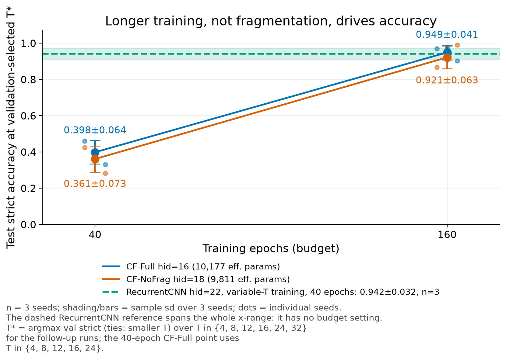
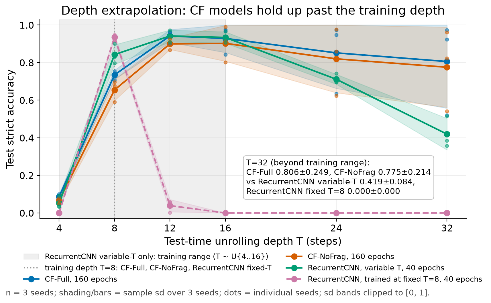
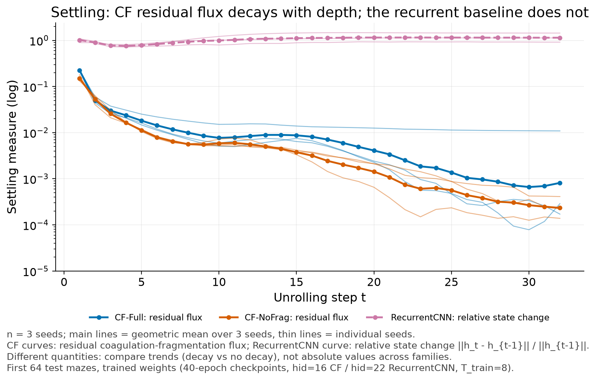

# Curriculum-results figures: budget, fragmentation, and depth extrapolation

All figures follow up on the maze benchmark (level-5 curriculum mazes — grid size 5, rendered as 11x11 ASCII — with
train/val/test 4000/1000/1000, trained at T_train=8 unless stated otherwise; three seeds 0, 1, 2 everywhere).
Every accuracy number shown (Figures F1 and F2) is test **strict accuracy** (a maze counts as strictly solved only if the
predicted support is exactly the BFS shortest path; on perfect mazes strict == exact); Figure F3 instead plots one settling
measure per model family — residual coagulation-fragmentation flux for the CF models, relative state change for
RecurrentCNN — two different quantities defined in the F3 section.
Aggregates are mean +- sample sd over the 3 seeds with individual seed dots shown (Figures F1 and F2); Figure F3 instead
aggregates with the geometric mean and shows one thin line per seed (see the F3 section for why).
Run codes E1-E4 in this README are cross-references to the source runs only; the figures themselves use plain model
descriptions.
All plotted values (means, sds where applicable, and per-seed values) are exported to
[`data.csv`](data.csv), which sits beside the figures so the plotted values travel with them
(the source JSONs of the main repository's results archive are git-ignored).

## F1 — Training budget x fragmentation



**Caption.** Test strict accuracy at the validation-selected horizon T* versus training budget
(40 vs 160 epochs) for CF-Full hid=16 (10,177 effective params) and the matched-capacity
ablation CF-NoFrag hid=18 (9,811 effective params). CF-Full at 40 epochs is the 40-epoch hid=16
run; RCNN hid=22 trained with variable T (E3, 40 epochs) is drawn as a horizontal dashed
reference line with its sd band, its legend entry giving the value (0.942 +- 0.032, n = 3).
T* = argmax val strict, ties to smaller T; the candidate set is T in {4, 8, 12, 16, 24, 32}
for the follow-up runs (E1, E2, E4 and the E3 reference), but T in {4, 8, 12, 16, 24} — no
T=32 candidate — for the 40-epoch CF-Full point.

**How to read.** X-axis: training epochs; within each series this is the knob being varied.
Note the two CF series also differ in hidden width (hid=16 vs hid=18, the capacity matching),
so the cross-series contrast is CF-Full vs CF-NoFrag at matched effective params, not at
matched width. Y-axis: test strict accuracy at T* per seed. Error bars and bands are sample
sd over 3 seeds; small dots are individual seeds (n = 3, sd, not SEM). Value labels beside
each CF point give mean +- sd and are placed outside the error-bar tips (above for CF-Full,
below for CF-NoFrag) so they never sit on a line or point; the script asserts this at render
time. The dashed green reference line is the E3 RecurrentCNN (variable-T training) mean with
its sd band: RecurrentCNN has no budget setting, so the line spans the full x-range and
there are deliberately no E3 dots at any x position — its legend entry carries the exact
value (0.942 +- 0.032, n = 3).

**Key takeaway.** Longer training is the main effect, not fragmentation. CF-Full improves
from 0.398 +- 0.064 (40 ep) to 0.949 +- 0.041 (160 ep); at matched effective capacity
CF-NoFrag improves from 0.361 +- 0.073 (40 ep) to 0.921 +- 0.063 (160 ep). At 160 epochs the
two overlap (0.949 +- 0.041 vs 0.921 +- 0.063) — fragmentation gives no detectable
final-accuracy benefit at matched capacity, at most a weak speed effect early in training.
The variable-T RCNN reference reaches 0.942 +- 0.032 in only 40 epochs (but see F2 for its
collapse off-horizon).

**Data source.** Main repository results archive: `valT_selection.json` (CF-Full hid=16, 40 ep,
test_strict_at_T_star per seed) and `followups/results.json`
(E1_CF-Full 160 ep, E2_CF-NoFrag 40 ep, E4_CF-NoFrag160, E3_RecurrentCNN; per-seed
`test_strict_at_T_star`). Aggregated in `data.csv` under "F1 budget x fragmentation".

**Caveats.** n = 3 seeds, so sds are noisy estimates of spread. The 40-epoch CF-Full point
comes from the 40-epoch hid=16 runs (different hidden width than the follow-up CF-NoFrag
hid=18), which is why CF-NoFrag is the capacity-matched comparison (9,811 vs 10,177
effective params). CF-Full 160-ep seeds chose T* = 16, 16, 12 and the 160-epoch
CF-NoFrag seeds T* = 12, 12, 16, so at 160 epochs the evaluation horizon
co-varies with training length; the 40-epoch CF-NoFrag seeds all chose the
same T* = 16 (16, 16, 16).

## F2 — Depth extrapolation (test-time T sweep)



**Caption.** Test strict accuracy versus test-time unrolling depth T for CF-Full hid=16
(160 epochs; run E1), CF-NoFrag hid=18 (160 epochs; run E4), RecurrentCNN hid=22 trained with variable
T~U{4..16} (40 epochs; run E3), and the RecurrentCNN hid=22 trained at fixed T=8 (40 epochs).
The dotted grey line at T=8 is the training depth of every fixed-T model in the figure —
CF-Full (E1), CF-NoFrag (E4) and the fixed-T RecurrentCNN (config `T_train=8` in both
the archive's training-metrics JSON and `followups/results.json`; E3 samples
T ~ U{4..16} per batch instead) — while the grey band (4-16) is the training range of the
variable-T RecurrentCNN alone. Everything right of T=8 is past the fixed-T models' training depth, and
right of 16 past every model's, which is what the figure title refers to.

**How to read.** X-axis: number of steps the trained network is unrolled at test time.
Y-axis: test strict accuracy. Lines are seed means, shaded bands sample sd over 3 seeds
(clipped to [0, 1] — the CF-Full band at T >= 16 and the CF-NoFrag band at T = 24 would
otherwise cross 1.0; the figure footnote states this), small dots individual seeds
(n = 3, sd). The white boxed annotation gives the seed-mean +- sd values of all four
models at T=32; it sits in the empty strip between T=16 and T=32 below every band (the
only nearby data is the flat fixed-T RecurrentCNN line at 0, below it), and the render-time
check in the script verifies it overlaps no line, marker or band. Everything right of
the dotted T=8 line is beyond the training depth of the CF models and the fixed-T
RecurrentCNN; everything right of the grey band is beyond every model's training distribution.

**Key takeaway.** CF models degrade gracefully far past their training depth; RCNN does not.
At T=32 (4x the training depth of the CF models): CF-Full 0.806 +- 0.249, CF-NoFrag
0.775 +- 0.214, versus RCNN variable-T 0.419 +- 0.084 and RCNN fixed T=8 0.000 +- 0.000.
The seed spread on the CF models at T >= 24 is large (sd ~ 0.2, e.g. CF-Full T=24 seeds
0.947 / 0.974 / 0.634), so the size of the extrapolation advantage is seed-dependent; its
sign is consistent for the seed means at every T >= 24, but not seed-by-seed (at T=24,
CF-NoFrag seed 0 scores 0.623 versus 0.695 for RCNN variable-T seed 0). Variable-T training
removes RCNN's collapse inside its training range (T=12: 0.942 +- 0.032, T=16: 0.934 +- 0.030,
versus the fixed-T RCNN's 0.039 +- 0.033 at T=12 and 0.000 +- 0.000 at T=16) but not beyond
it — and it does not rescue T=4 (0.054 +- 0.034). CF-Full stays at 0.942 +- 0.034 at T=12
and 0.929 +- 0.075 at T=16 after 160 epochs, with accuracy declining only gradually by T=24
(0.852 +- 0.189) and T=32.

**Data source.** Main repository results archive: `followups/results.json` (per-seed `test_strict_by_T` for
E1_CF-Full, E4_CF-NoFrag160, E3_RecurrentCNN) and the training-metrics JSON
(fixed-T=8 RecurrentCNN per-seed sweep at T in {4, 8, 12, 16, 24, 32}). Aggregated
in `data.csv` under "F2 depth extrapolation".

**Caveats.** n = 3 seeds; sd bands widen for the CF models beyond T=16 because one seed
extrapolates far differently from the other two — and which seed that is differs by model:
seed 2 is the *worst* extrapolator for CF-Full (T=24: 0.634, T=32: 0.520, versus seed 1's
0.974 / 0.974) but the *best* for CF-NoFrag (T=24: 0.977, T=32: 0.961). The two RCNN variants
differ only in training-time horizon sampling (fixed T=8 vs T~U{4..16}), so the grey band
applies to the E3 RCNN alone. CF models were trained 160 epochs here while E3 RCNN was
trained 40 epochs; per Figure F1 both budgets sit at the same accuracy at their selected T*,
so the comparison is about extrapolation behavior, not peak accuracy.

## F3 — Settling: settling measures vs unrolling depth



**Caption.** Per-step settling measures of the trained 40-epoch checkpoints
(T_train=8) on the first 64 test mazes, unrolled for 32 steps (log scale), for
CF-Full hid=16, CF-NoFrag hid=16, and RecurrentCNN hid=22. For the CF models the measure
is the residual coagulation-fragmentation flux at step t; for RecurrentCNN the analogous
quantity is the relative state change ||h_t - h_{t-1}|| / ||h_{t-1}||. These are two
different quantities: the figure compares trends (decay vs no decay), not absolute values
across families — the legend labels name the quantity each curve plots, and the figure
footnote states the same.

**How to read.** X-axis: unrolling step t (1-32). Y-axis: settling measure, log scale.
A curve falling toward 10^-4 means the network's internal state settles into a fixed
point; a curve staying near 1 keeps changing by order-one amounts every step. Thick lines
are the geometric mean over the 3 seeds per step, thin semi-transparent lines the
individual seeds, colour-coded per family (same colour as the family's mean). On a log
axis the geometric mean is the appropriate aggregate: the earlier arithmetic mean +- sd
band presentation was misleading here, because at late steps the CF-Full sd exceeds its
mean and the band collapsed to the axis floor. There is no sd band and nothing is
clipped in this figure; the per-seed lines show the spread directly and in full.

**Key takeaway.** The CF chemistry settles; the recurrent baseline does not. The
geometric-mean residual flux decays from 0.225 (step 1) to 0.000813 (step 32) for CF-Full
and from 0.150 (step 1) to 0.000233 (step 32) for CF-NoFrag — about 280x and 640x
reductions over the unroll, with CF-NoFrag settling deepest. RecurrentCNN's
geometric-mean relative state change stays order-one throughout, from 1.015 (step 1) to
1.144 (step 32): its hidden state keeps churning instead of converging to a fixed point.

**Data source.** `settling` arrays (one value per step, steps 1-32) of the 40-epoch trained
runs in the results archive's training-metrics JSON, computed by `cf/train.py:settling_curve` on the
first 64 test mazes with the trained weights. Aggregated in `data.csv` under "F3 settling":
the mean column holds the geometric mean over the 3 seeds at that step, the sd column is
empty (no sd is shown in the figure), and the seed0-2 columns hold the per-seed values.

**Caveats.** n = 3 seeds and only 64 test mazes enter the average. The CF-Full seed-1 curve
re-bounces (its step-32 value is 0.0109 versus 0.000288 and 0.000171 for seeds 0 and 2), so
its thin line stays orders of magnitude above the other two seeds at the right edge and
pulls the geometric mean (8.1e-4 at step 32) above two of its own seeds; the per-seed
lines make this visible. The two measures are dimensionally different (a chemical flux vs
a relative state change), so only the shape (decay vs no decay) is comparable across
families, not absolute values.

---

## Reproducing

```bash
python scripts/figures/curriculum_figures.py
```

Reads `followups/results.json`, `valT_selection.json` and the training-metrics JSON of the
main repository's results archive (under the repository root, or pass `--root`),
and rewrites `budget_vs_fragmentation.png`, `depth_extrapolation.png`, `settling.png` and
`data.csv` in this folder. The Okabe-Ito colourblind-safe palette and rcParams live in
`scripts/figures/style.py`, shared by all figure scripts.
