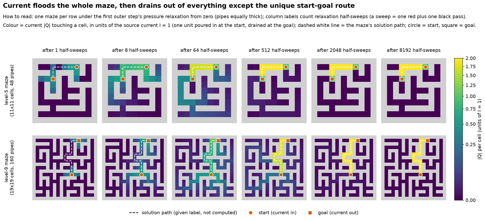
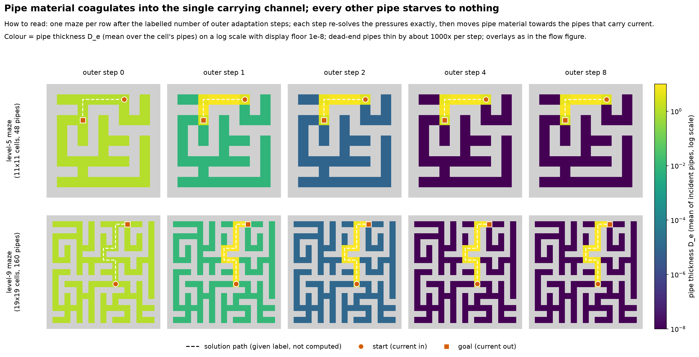
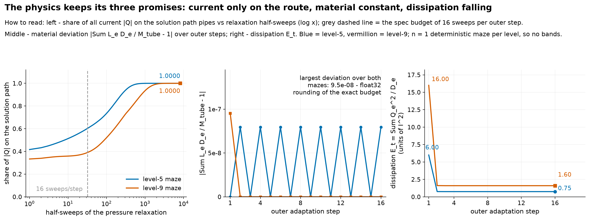

# Transport mechanism: how the physics alone solves the maze

These figures show the transport coagulation-fragmentation model
(cf/models/transport.py, specification docs/specs/family_d_transport.md)
in its physics-only arm: ZERO learned parameters (verified: the sum of
all parameter counts is 0; raw 0, effective 0), uniform pipe lengths
L_e = 1, adaptation f_e = |Q_e| + eps_f with eps_f = 1e-3, source
current I = 1. There is no training phase (0 epochs, 0 minutes of
training, 0 seeds): the run is deterministic, so no bands and no
standard deviations appear anywhere below.

## The run

| item | value |
| --- | --- |
| arm | physics-only transport, no learning (params raw 0 / effective 0) |
| training | none: 0 epochs, 0 seeds, 0 minutes |
| mazes | maze index 0 of the seeded level-5 test split and maze index 0 of the seeded level-9 probe split (splits seed 0, the same splits as every run in this repository; the rule is fixed in advance, none was picked after looking at results) |
| maze level-5 | 11x11 cells, 49 free cells, 48 pipes, path 7 cells / 6 pipes |
| maze level-9 | 19x19 cells, 161 free cells, 160 pipes, path 17 cells / 16 pipes |
| n | 1 maze per level (deterministic; sd not applicable); the population statement is the stored evaluation: test strict at T = 8: 1.000 (level-5 test, n = 1000 mazes) and 1.000 (level-9 probe, n = 1000 mazes); strict is 1.000 at EVERY measured horizon T in [1, 2, 4, 8, 16, 32, 64] (the arm has no training and no validation selection, so no T* is defined) - from the stored evaluation run results/transport_physics/results.json, exact relaxation, CPU |
| hardware | CPU only (local GPU disabled by the run environment), torch 2.11.0+cu128, Windows-11-10.0.26300-SP0 |
| budget | sweep scan 8192 half-sweeps per maze, exact rollout 16 outer steps per maze, audit rollout 12 outer steps at the spec budget; total figure wall time 0.3 min CPU; stored set-level evaluation level5_test: 11 s for 1000 mazes, probe9: 177 s for 1000 mazes |

## flow_sweeps.png

**Caption.** Current maps |Q| per cell on the two mazes while the
first outer step's pressure relaxation runs, at
1, 8, 64, 512, 2048, 8192 half-sweeps out of the 8192 computed. Pipes are all equally thick (the
initial state); the pressures start at zero; the relaxation is the
two-colour Gauss-Seidel sweep of the model (one sweep = one red plus
one black pass).

**How to read.** Colour = total current |Q| through the pipes touching
a cell, in units of the source current I = 1 (the cell value is a SUM
over the pipes touching the cell, so it can exceed 1 - 2.00, the top of
the colour scale, is the largest cell value over all shown snapshots,
on the converged maps a path cell where two path pipes, each carrying
the full unit, meet; the colour scale is a power scale (gamma 0.45) on
[0, 2.00]). White dashed line = the maze's solution path (the given
label, not computed); circle = start (current in), square = goal
(current out); grey cells are walls. n = 1 maze per level,
deterministic, so no bands or error bars apply.

**Key takeaway.** The current spreads from the source and the sink
into every corridor, then drains out of the dead ends and collapses
onto the solution path: the share of |Q| on the path pipes rises from
0.417 after 1 half-sweep to 1.000 at 8192 half-sweeps on the level-5 maze
(residual 1e-15), and from 0.333 to 1.000 at 8192 half-sweeps on the
level-9 maze (residual 3e-10). On a maze without loops no steady
current can enter a dead-end corridor and every pipe on the unique
route carries the full unit - so 'dark' means 'no current can ever
flow there'.

**Data source.** cf/models/transport.py (sweep relaxation);
data.csv, section sweeps_first_step; mazes from the seeded curriculum
splits (cf/data/curriculum.py, dataset selimaktas/maze-curriculum-
dataset, splits seed 0).

**Caveats.** The snapshot is inside the FIRST outer step only (uniform
pipes); the specification's per-step relaxation budget is 16 sweeps =
32 half-sweeps, and the grey dashed line in monitors.png shows where
that budget sits on the convergence path (share 0.603 and 0.391 at exactly
32 half-sweeps for the two mazes). One maze per level; the same
mechanism gives strict accuracy 1.000 on all 1000 mazes of each set
in the stored evaluation.

## tube_material.png

**Caption.** Pipe thickness D_e (per cell: the mean over the pipes
touching it) on the same two mazes over outer adaptation steps 0, 1, 2, 4, 8.
Each re-solves the pressures exactly (float64 linear solve), then
redistributes the material: D_e <- M_tube * D_e f_e / Sum D_e f_e with
f_e = |Q_e| + eps_f, so the material budget is exactly conserved.

**How to read.** Colour = pipe thickness on a LOG scale from a display
floor of 1e-8 (stated clip: values below the floor, including the exact
zeros reached by starving pipes, are drawn at the floor colour) up to
10.0, the largest value over the shown maps. Step 0 is the initial
state: every free pipe equally thick (D_e = 1, so the material budget
equals the pipe count: 48 pipes level-5, 160 pipes level-9).
White dashed line / markers as in the flow figure. n = 1 maze per
level, deterministic; no bands.

**Key takeaway.** The material coagulates into the single carrying
channel: after 8 steps, 1.000000 of the budget sits on the path pipes of
the level-9 maze (1.000000 on the level-5 maze), each path pipe thickness
has grown to the budget share M_tube / path pipes = 8.0 (level-5)
and 10.0 (level-9), and the thickest starving dead-end pipe is down
to 7.9e-24 and 9.9e-24 (fragmentation of the rest: about a factor 1000 thinner
per step). The carrying channel is the exact solution path.

**Data source.** cf/models/transport.py (exact relaxation and the
redistribution step); data.csv, section outer_steps_exact (columns
material_on_path_share and dead_D_max); same mazes as above.

**Caveats.** on the full sets the exact solve degenerates on some mazes from outer step 6 onward (the stored evaluation holds such a maze's flow at its last conservation-valid value; on a tree that is the exact flow for all later steps). The two mazes shown here keep their exact solves
conservation-valid through all 16 steps (largest per-step residual
5e-15), so no hold policy was needed. One maze per level.

## monitors.png

**Caption.** The three promised invariants of the update, on the same
two mazes: the share of all |Q| on the solution path tends to 1 as the
relaxation converges (left); the material budget Sum L_e D_e stays
constant (middle; with L_e = 1 it is Sum D_e, and the exact statement
is |Sum D_e / M_tube - 1| <= float32 rounding); the dissipated
energy E_t = Sum Q_e^2 / D_e decreases over the outer steps (right).

**How to read.** Left: x = half-sweeps of the first step's relaxation
(log scale), y = share of |Q| on the path pipes (0-1); the grey dashed
line marks the spec budget of 16 sweeps (= 32 half-sweeps) per outer
step. Middle and right: x = outer adaptation step (each step = one
exact pressure solve plus one material redistribution); middle y =
the material deviation |Sum L_e D_e / M_tube - 1| on a linear scale 0
to 1.45e-7; right y = E_t. Blue = level-5 maze, vermillion = level-9
maze; circles mark level-5 endpoints, squares mark level-9 endpoints.
n = 1 deterministic maze per level, so no sd / bands are shown.

**Key takeaway.** (1) The path share of |Q| rises to 1.0000 (level-5,
8192 half-sweeps) and 1.0000 (level-9, 8192 half-sweeps); with the exact
pressure solve it is already 1.0000 at outer step 1 and stays there -
on a tree the conserved flow is unique. (2) The material deviation
never exceeds 9.5e-08 over both mazes and all 16 steps (float32
rounding; conservation is exact by construction). (3) The dissipation
falls from 6.00 to 0.75 (-87.5%) on the level-5 maze and from 16.00
to 1.60 (-90.0%) on the level-9 maze, plateauing at the value
path pipes / (M_tube / path pipes) = 0.75 and 1.60 - thickening the
route is what lowers the dissipated energy.

**Data source.** data.csv, sections sweeps_first_step (left panel),
outer_steps_exact (middle and right panels); cf/models/transport.py.

**Caveats.** The sweep-relaxation curves (left panel) are inside the
first outer step from a zero-pressure start; across outer steps run
at the spec budget of 16 sweeps the bigger maze under-relaxes (audit
run in data.csv, section outer_steps_sweep_budget16: at step 1 the
level-9 residual is 2e-01 and by step 12 the unit current is cut, total
|Q| = 2.00 on 16 path pipes - that is a property of the fixed sweep
budget on the 19x19 grid, not of the physics) - the outer-step panels
use the exact solve instead (largest residual 5e-15 over 16 steps).
Neither maze's exact solve degenerated within the shown horizon, so the hold policy of the stored evaluation was never triggered here. The dissipation E_t is the unit-length form Sum Q_e^2/D_e used by
the model's own diagnostics; with L_e = 1 it equals the resistor
network's true dissipated energy.

## data.csv

One row per measurement. Sections: maze_meta (cell/pipe/path counts and
the material budget M_tube), sweeps_first_step (one row per
half-sweep of the first outer step's relaxation: path share,
conservation residual, total |Q|, max cell |Q|), outer_steps_exact
(one row per outer step with the exact solve: path share, residual,
total |Q|, material deviation, dissipation, thickest dead-end pipe,
material share on the path pipes), outer_steps_sweep_budget16 (audit
run at the spec's 16-sweep relaxation budget).

## Figure audit

Programmatic readability audit (each text's window extent against
every other text and every sampled line/marker point): flow_sweeps.png: pass; tube_material.png: pass; monitors.png: pass
All text is 11 pt or larger; fixed colours from scripts/figures/
style.py (Okabe-Ito); every figure carries its own legend or scale.
